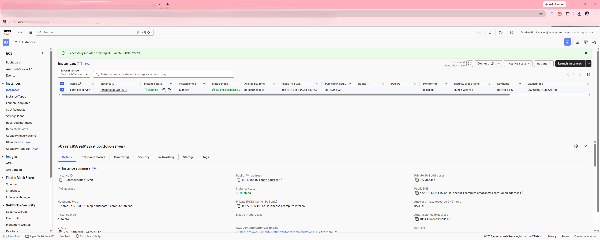
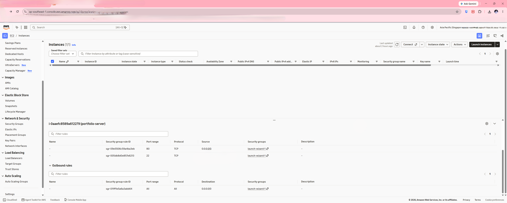
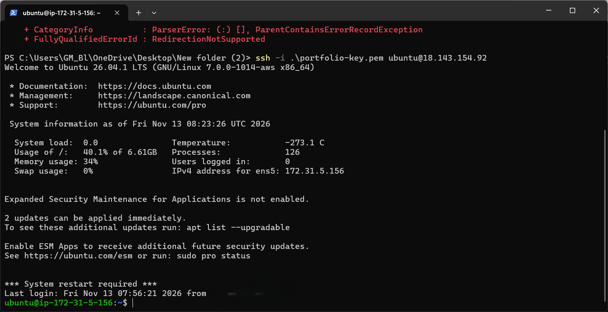
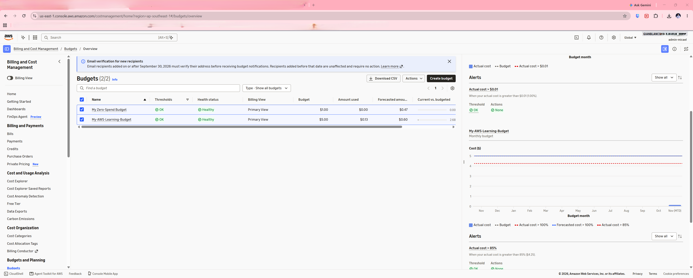
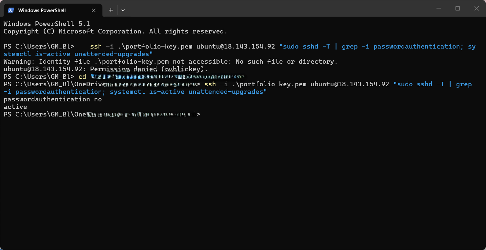

# Secure Cloud-Hosted Portfolio on AWS EC2

**Author:** Gian Micael Blanco
**Role target:** Cloud Engineer / IT Support / IT Security Operations

A personal portfolio website hosted on my own AWS EC2 server, built as my first cloud project.
The goal was to learn how to launch, secure, and automate a Linux server on AWS.

**Live site:** http://18.143.154.92

## About Me
I am an Electronics Engineering graduate with professional experience in security systems operations,
CCTV infrastructure, IP networking, and technical troubleshooting. I am currently expanding my
expertise in cloud computing, AWS, Linux, and cybersecurity through hands-on projects and practical
training. My goal is to build a career in Cloud Engineering and IT Security Operations.

## Contact
- Email: [micaelblanco1@gmail.com](mailto:micaelblanco1@gmail.com)
- LinkedIn: [linkedin.com/in/gianmicaelblanco](https://www.linkedin.com/in/gianmicaelblanco)
- GitHub: [github.com/GianMicaelBlanco](https://github.com/GianMicaelBlanco)

## What I Built
- Launched an Ubuntu EC2 instance (free-tier eligible `t3.micro`) in the Singapore region
- Installed and configured **Nginx** to serve a static website
- Restricted **SSH** access to my own IP using a Security Group, with HTTP open to the public
- Logged in with an SSH **key pair** (no password login)
- Enabled the **UFW firewall** and **fail2ban** to block brute-force attempts
- Turned on **automatic security updates**
- Automated the whole setup with an **EC2 User Data** script (`user-data.sh`)
- Used an **IAM user with MFA** instead of the root account
- Set the instance credit specification to **Standard** and created an AWS **budget alert** to avoid unexpected costs

## Skills Demonstrated
AWS EC2 | AWS IAM | Linux (Ubuntu) | Nginx | SSH & Security Groups | UFW Firewall | fail2ban |
Git & GitHub | IP Networking | Security Systems & CCTV Infrastructure | Troubleshooting

## Architecture

```
Visitor (Browser)
      |
      v
 Internet --> Security Group (port 22 from my IP only, port 80 public)
      |
      v
 EC2 Instance (Ubuntu) -- UFW firewall -- Nginx -- index.html
```

> Add a proper diagram image here (made with draw.io) and link it:
> ``

## Screenshots
| Step | Screenshot |
|------|-----------|
| EC2 instance running |  |
| Security group rules |  |
| SSH connection |  |
| Nginx, firewall and fail2ban status |  |
| Live website |  |
| Budget alert |  |
| Verified: password login off, auto-updates on |  |

## Security Decisions
- **Two firewall layers:** the AWS Security Group allows SSH only from my IP, and UFW on the server allows only SSH and web ports.
- **Key pair only**, because passwords can be guessed.
- **IAM user with MFA, not root**, for daily work.
- **fail2ban** bans IPs that repeatedly fail to log in.
- **Automatic updates** patch known vulnerabilities.
- **Standard credit mode** on the `t3.micro`, so a traffic spike cannot create extra CPU charges.
- The private key (`.pem`) is **never** committed to GitHub (see `.gitignore`).

## Problems I Faced and How I Fixed Them
- **Site timed out right after launch.** The User data script was still installing Nginx. I waited a few minutes and it loaded.
- **Used the wrong IP address.** I first typed the private IP (`172.31.x.x`), which only works inside AWS. The public IPv4 address is the one for a browser.
- **EC2 Instance Connect failed.** With SSH restricted to my own IP, the browser-based connect button could not reach the server. I connected from my own PC instead.
- **PuTTY could not use my `.pem` key.** PuTTY needs `.ppk` format, so I converted the key with PuTTYgen. I also connected with the built-in Windows OpenSSH client, which reads `.pem` directly.
- **"No supported authentication methods" in PuTTY.** The key file was not loaded in the session settings.
- **SSH session dropped.** A reset connection sent me back to my local PowerShell, so I reconnected and re-ran the checks.
- **GitHub link returned 404.** I had guessed my username wrong. I corrected it in the website and the repo files.
- **Public IP changes after stop/start.** I stop the instance to save cost, so the live link changes when I start it again. An Elastic IP would fix this.

## What I Learned
- How to launch and configure an EC2 instance, including security groups, key pairs and User data scripts.
- The difference between a public and a private IP address on AWS.
- How SSH key authentication works, and why key formats matter (`.pem` vs `.ppk`).
- Layered security: Security Group, UFW firewall, fail2ban and key-only login.
- Cost control: free-tier instance types, credit specification, budgets, and stopping instances I am not using.
- How to read errors and troubleshoot step by step instead of guessing.

## Commands Used
```bash
sudo apt update && sudo apt upgrade -y
sudo apt install nginx -y
sudo systemctl status nginx
sudo ufw status
sudo fail2ban-client status sshd
```

## Next Steps
- Attach an Elastic IP so the address stays the same
- Add a custom domain and free HTTPS with Let's Encrypt
- Replace the broad admin permissions on my IAM user with least-privilege policies
- Add a CloudWatch alarm for CPU usage
- Rebuild the setup with Terraform
- Deploy automatically with GitHub Actions

## Files in This Repo
- `index.html` : the portfolio website
- `user-data.sh` : automatic server setup script
- `README.md` : this document
- `.gitignore` : keeps secret keys out of GitHub

---
Built by Gian Micael Blanco
