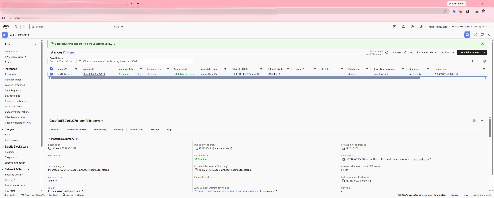
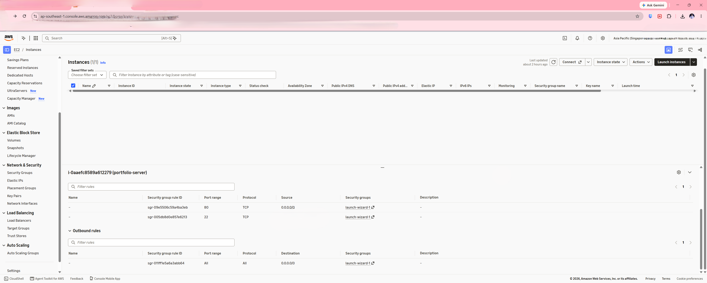
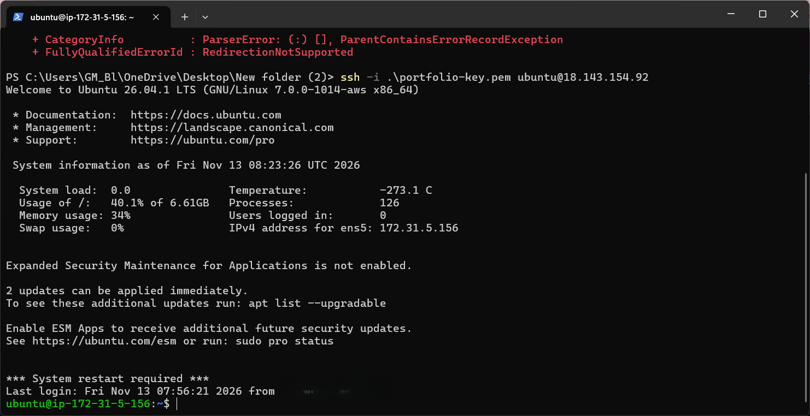
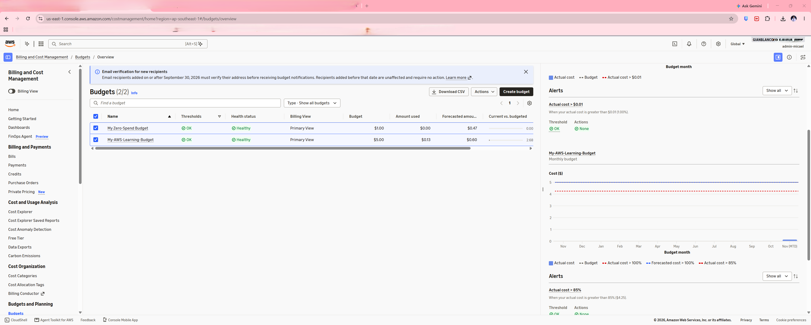

# Secure Cloud-Hosted Portfolio on AWS EC2

**Author:** Gian Micael Blanco
**Role target:** Cloud Engineer / IT Support / IT Security Operations

A personal portfolio website hosted on my own AWS EC2 server, built as my first cloud project.
The goal was to learn how to launch, secure, and automate a Linux server on AWS.

**Live site:** http://YOUR-SERVER-IP  <!-- replace with your server's public IP or domain after launching -->

## About Me
I am an Electronics Engineering graduate with professional experience in security systems operations,
CCTV infrastructure, IP networking, and technical troubleshooting. I am currently expanding my
expertise in cloud computing, AWS, Linux, and cybersecurity through hands-on projects and practical
training. My goal is to build a career in Cloud Engineering and IT Security Operations.

## Contact
- Email: [gianmicaelblanco1@gmail.com](mailto:gianmicaelblanco1@gmail.com)
- LinkedIn: [linkedin.com/in/gianmicaelblanco](https://www.linkedin.com/in/gianmicaelblanco)
- GitHub: [github.com/GianMicael](https://github.com/GianMicael)

## What I Built
- Launched an Ubuntu EC2 instance (free-tier eligible `t3.micro` / `t2.micro`)
- Installed and configured **Nginx** to serve a static website
- Restricted **SSH** access to my own IP using a Security Group
- Logged in with an SSH **key pair** (no password login)
- Enabled the **UFW firewall** and **fail2ban** to block brute-force attempts
- Turned on **automatic security updates**
- Automated the whole setup with an **EC2 User Data** script (`user-data.sh`)
- Used a restricted **IAM user** instead of the root account
- Set an AWS **budget alert** to avoid unexpected costs

## Skills Demonstrated
AWS EC2 | AWS IAM | Linux (Ubuntu) | Nginx | SSH & Security Groups | UFW Firewall | fail2ban |
Git & GitHub | IP Networking | Security Systems & CCTV Infrastructure | Troubleshooting

## Architecture

```
Visitor (Browser)
      |
      v
 Internet --> Security Group (port 22 from my IP only, ports 80/443 public)
      |
      v
 EC2 Instance (Ubuntu) -- UFW firewall -- Nginx -- index.html
```

> Add a proper diagram image here (made with draw.io) and link it:
> ``

## Screenshots
| Step | Screenshot |
|------|-----------|
| EC2 instance running |  |
| Security group rules |  |
| SSH connection |  |
| Nginx running |  |
| Live website |  |
| Budget alert |  |

## Security Decisions
- **SSH limited to my IP** so strangers cannot even try to connect.
- **Key pair only**, because passwords can be guessed.
- **IAM user, not root**, following least-privilege practice.
- **fail2ban** bans IPs that repeatedly fail to log in.
- **Automatic updates** patch known vulnerabilities.
- The private key (`.pem`) is **never** committed to GitHub.

## Problems I Faced and How I Fixed Them
<!-- Write your real problems here. Recruiters love this section. Examples:
- "Permission denied (publickey)": fixed by running chmod 400 on my key file.
- "Site not loading": the Security Group had no inbound rule for HTTP (port 80).
-->

## What I Learned
<!-- 3-5 bullet points in your own words -->

## Commands Used
```bash
sudo apt update && sudo apt upgrade -y
sudo apt install nginx -y
sudo systemctl status nginx
sudo ufw status
sudo fail2ban-client status sshd
```

## Next Steps
- Add a custom domain and free HTTPS with Let's Encrypt
- Add a CloudWatch alarm for CPU usage
- Rebuild the setup with Terraform
- Deploy automatically with GitHub Actions

## Files in This Repo
- `index.html` : the portfolio website
- `user-data.sh` : automatic server setup script
- `README.md` : this document
- `.gitignore` : keeps secret keys out of GitHub

---
Built by Gian Micael Blanco
